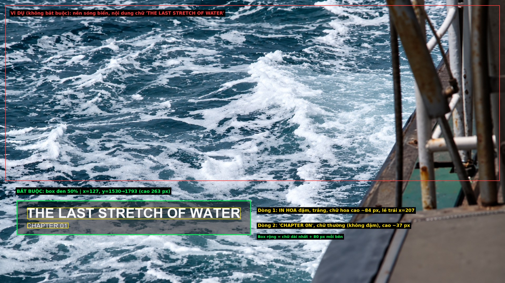
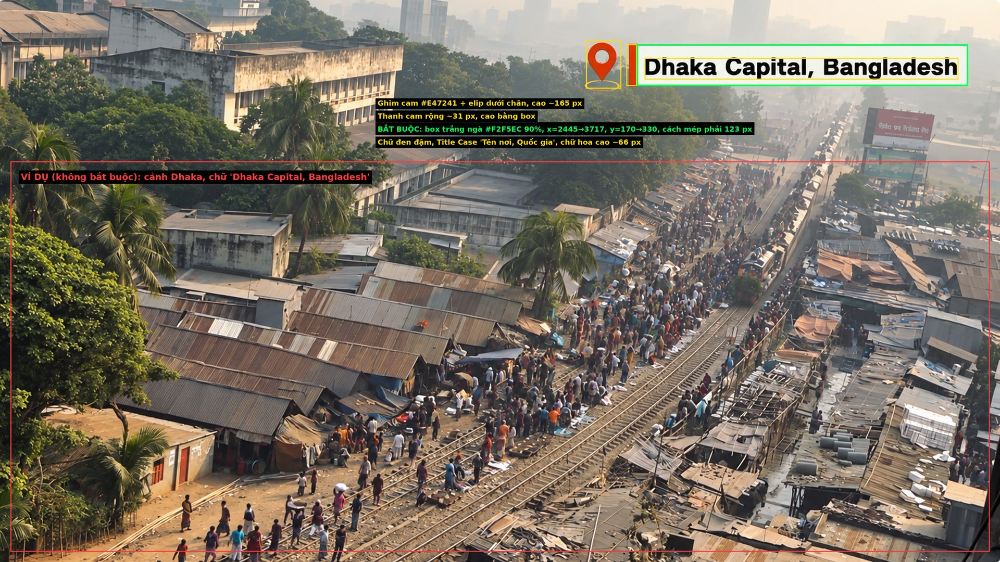
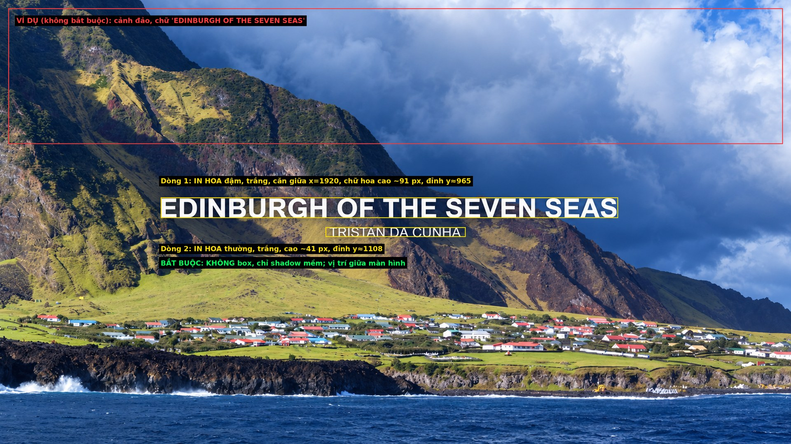

# Text style — Chapter, Location, Annotation (từ 07/10/2026)

**ĐỌC KỸ:** Mọi text trong phim chỉ dùng **3 kiểu** dưới đây. Mở ảnh mẫu và ảnh hướng dẫn trước khi làm.
- Ảnh mẫu gốc: `E:\Youtube AI\Hidden Chapters\Text example` (bản sao trong `visuals/text-example-v32/`).
- Ảnh hướng dẫn `*-guide.jpg`: khung **xanh lá** = phải làm giống, khung **vàng** = chữ, khung **đỏ** = chỉ là ví dụ, KHÔNG phải làm theo (nền, nội dung chữ).
- Số đo dưới đây chỉ để tham khảo, tính theo khung 3840×2160. **Làm tương đối giống mẫu là đạt**, không cần chính xác từng pixel.
- Animation tính ở 30 fps. Nếu timeline fps khác thì giữ nguyên số giây.

---

## THẺ 1 — CHAPTER (tiêu đề chương)

**Dùng khi:** bắt đầu mỗi chương, vào đúng lúc câu VO đầu tiên của chương bắt đầu, trên footage của chương đó.

**Trông như thế nào:**
- Box đen mờ khoảng 50%, góc dưới bên trái, không bo góc, không viền.
- Dòng 1: tên chương, IN HOA, chữ đậm, màu trắng, cỡ lớn.
- Dòng 2: `CHAPTER 01`, `CHAPTER 02`…, IN HOA, chữ thường (không đậm), màu trắng, cỡ nhỏ.
- Hai dòng căn trái. Box rộng vừa đủ ôm chữ, chừa lề hai bên.

**Số tham khảo (3840×2160):** box bắt đầu từ x≈127, y≈1530 đến y≈1793. Chữ dòng 1 cao khoảng 84 px, dòng 2 khoảng 37 px.

**Animation:**

| Lúc | Việc |
|---|---|
| 0 → 0,5 giây | Box mở ra từ trái sang phải |
| 0,15 → 0,55 giây | Dòng 1 hiện dần và trượt nhẹ sang phải |
| 0,25 → 0,65 giây | Dòng 2 hiện dần |
| giữa | Giữ yên, ít nhất 3,5 giây |
| 0,6 giây cuối | Chữ mờ dần, rồi box thu lại về bên trái |

**KHÔNG ĐƯỢC:** box màu khác, bo góc, viền chữ, đặt chữ giữa màn hình, âm thanh whoosh.

---

## THẺ 2 — LOCATION (tên địa điểm)

**Dùng khi:** câu VO nhắc tới một địa điểm thật (thành phố, vùng, quốc gia) và hình đang chiếu đúng nơi đó. Vào lúc câu đó bắt đầu.

**Trông như thế nào (trái → phải, góc trên bên phải):**
1. Icon ghim bản đồ màu cam, có hình elip nhỏ dưới chân.
2. Thanh dọc màu cam, mảnh.
3. Box màu trắng ngà, gần như không trong suốt, không bo góc.
4. Chữ màu đen, đậm, dạng `Tên nơi, Quốc gia` (viết hoa chữ cái đầu, không IN HOA toàn bộ).

**Số tham khảo (3840×2160):** cả khối nằm ở góc trên phải, box khoảng x 2445→3717, y 170→330. Chữ cao khoảng 66 px. Màu cam ≈ `#E47241`, trắng ngà ≈ `#F2F5EC`. Box dài ra hoặc ngắn lại theo độ dài chữ.

**Animation:**

| Lúc | Việc |
|---|---|
| 0 → 0,25 giây | Ghim rơi nhẹ từ trên xuống và hiện ra |
| 0,15 → 0,35 giây | Thanh cam dựng lên |
| 0,25 → 0,65 giây | Box mở ra từ thanh cam sang phải |
| 0,4 → 0,75 giây | Chữ hiện dần |
| giữa | Giữ yên, ít nhất 3 giây |
| 0,4 giây cuối | Thu lại theo thứ tự ngược |

**KHÔNG ĐƯỢC:** đặt ở góc dưới, đổi màu cam sang màu khác, bỏ icon ghim, dùng cho nơi không đúng với hình.

---

## THẺ 3 — ANNOTATION (chú thích giữa màn hình)

**Dùng khi:** cần nhấn mạnh tên địa danh/công trình chính, một năm/ngày quan trọng, hoặc một số liệu ngắn. Dùng thưa, không phải câu nào cũng có.

**Trông như thế nào:**
- Chính giữa màn hình, **không có box**.
- Dòng 1: IN HOA, chữ đậm, màu trắng, cỡ lớn. Đây là thông tin chính.
- Dòng 2: IN HOA, chữ thường, màu trắng, cỡ nhỏ, ngay bên dưới. Đây là ngữ cảnh ngắn.
- Có bóng đổ mềm để đọc được trên nền sáng; không viền chữ.

**Số tham khảo (3840×2160):** chữ dòng 1 cao khoảng 91 px, dòng 2 khoảng 41 px, khối chữ nằm quanh giữa khung theo chiều dọc.

**Animation:**

| Lúc | Việc |
|---|---|
| 0 → 0,6 giây | Dòng 1 hiện dần, hơi thu nhỏ về đúng cỡ |
| 0,2 → 0,6 giây | Dòng 2 hiện dần và trượt nhẹ lên |
| giữa | Giữ yên, ít nhất 3 giây |
| 0,4 giây cuối | Cả khối mờ dần |

**KHÔNG ĐƯỢC:** thêm box nền, đặt ở góc, dùng cho câu dài.

---

## Cách làm trong DaVinci Resolve

1. Làm 3 Fusion Title template tên `HC_Chapter_v32`, `HC_Location_v32`, `HC_Annotation_v32`, mỗi cái có ô nhập Title và Subtitle. Text phải sửa được, không xuất ra ảnh hay video.
2. Thử mỗi template một lần trên timeline test, xem nhanh một khung hình lúc text đang giữ yên, so với ảnh mẫu. **Nhìn tương đối giống là dùng được**, không cần đo đạc.
3. Áp cho phim. Thời gian giữ co giãn theo độ dài clip; animation vào/ra giữ nguyên.

**Luôn nhớ:** chỉ 3 kiểu trên; không whoosh; không nhãn "AI"; không để hai text chồng nhau; tránh che mặt người.
