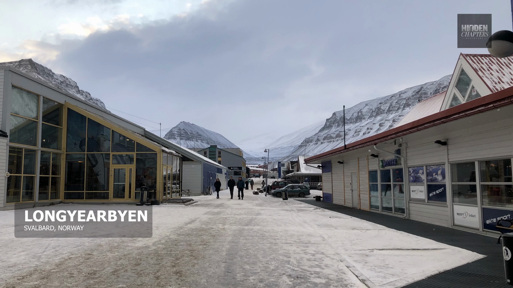
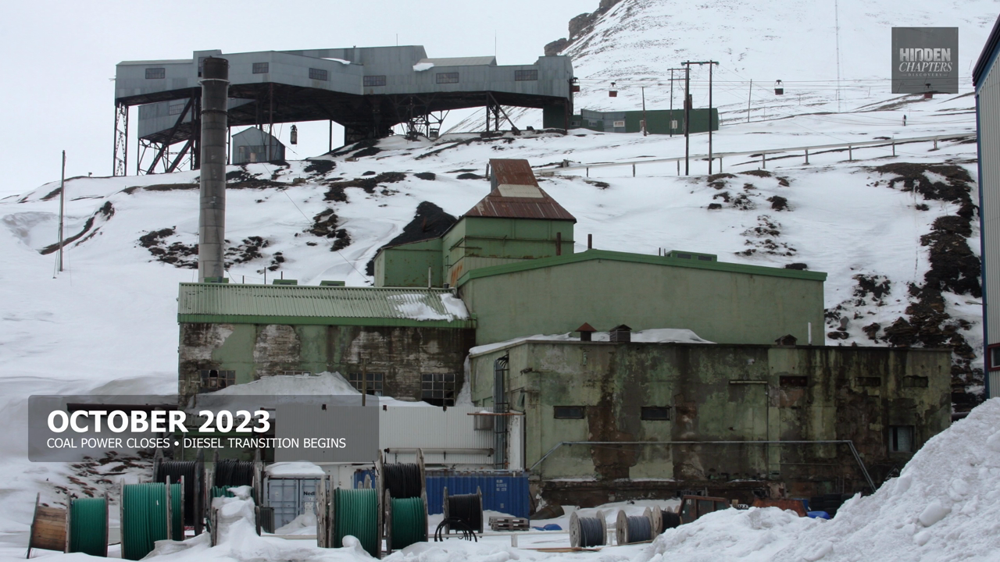
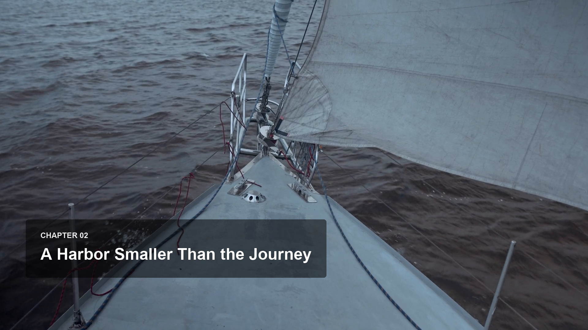

# Hình đối chiếu — chỉ mở nhóm phù hợp bước đang làm

Các ảnh đã được copy vào gói, không chỉ trỏ về Temp. [Nguồn/hash/phạm vi](SOURCES.json). Hình ví dụ phục vụ đối chiếu biên tập nội bộ, không phải kho stock được cấp phép dùng lại trong phim khác.

## Text trong phim — bước 07

**Mẫu mặc định cập nhật ver11:** [chapter/location/fact thực tế Tristan v27](TEXT_DEFAULTS.md). Hình Longyearbyen dưới đây giữ để đối chiếu thêm; proxy chapter cũ không là chuẩn native mới.

**Location: khung thật từ Longyearbyen final ở 100s.** Đối chiếu lower-left, chữ trắng không viền, hai dòng cùng căn trái, padding và box mờ. Không copy nguyên tọa độ nếu che chủ thể/caption của phim mới.

**Fact/date: khung thật ở 638s.** Box bao dòng dài nhất; phân cấp ngày lớn/dòng giải thích nhỏ. Đây là mẫu hình thức, không phải nguồn xác minh fact cho phim mới.

**Chapter Tristan: proxy composite.** Chỉ tham khảo phân cấp/padding/cỡ chữ trên nền. Chưa dùng làm bằng chứng title đã hiện đúng trong Resolve; project mới vẫn cần native render/viewer.

## Thumbnail va logo

Nguồn chính trên máy: `E:\Youtube AI\Hidden Chapters`. Các bản copy dưới đây giúp mang playbook sang nơi khác; tại máy này ưu tiên file gốc nếu user cập nhật brand. Style thumbnail có chữ lớn/viền theo mẫu riêng; không áp style này vào text trong phim.

[Logo](brand/logo.png) · [Logo overlay](brand/logo%20overlay.png) · [4K icon](brand/4k%20Icon.png).

Khi thêm mẫu mới: copy ảnh vào nhóm này, ghi original path + hash + timestamp nếu từ video, ghi approved/reference-only/rejected; link trực tiếp từ bước liên quan. Không chọn ảnh làm chuẩn chỉ vì nó tồn tại trong thư mục QC.

## Documentary explanatory illustrations

[User-selected detailed infographic direction and correction rules](DOCUMENTARY_GRAPHICS.md). This is distinct from chapter/location and thumbnail typography.

## Native verification — 03/10/2026
Native chapter/location/mechanism examples with measured fixes and explicit scope: [La Rinconada](../reference/LA_RINCONADA_NATIVE_FIXES.md).
