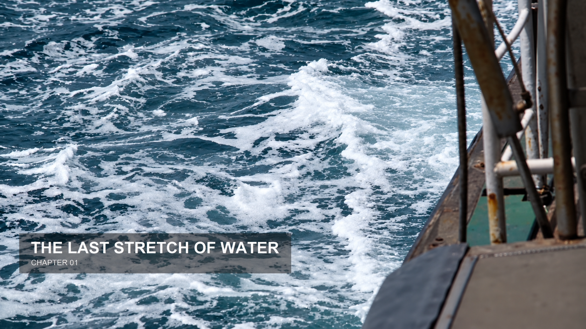
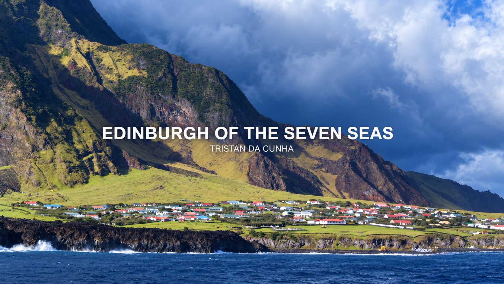

# Text defaults — mẫu chuẩn từ 07/10/2026

**Dùng 3 mẫu dưới đây cho mọi text trong phim, làm tương đối giống là đạt.** Ảnh hướng dẫn có chú thích: `text-example-v32/*-guide.jpg` (xanh = phải giống, vàng = chữ, đỏ = chỉ là ví dụ). Thông số đầy đủ (vị trí, cỡ chữ, màu, animation in/out trong DaVinci Resolve): [TEXT_STYLE_V32](../reference/TEXT_STYLE_V32.md). Bản gốc của người dùng: `E:\Youtube AI\Hidden Chapters\Text example`.

## Chapter
Box xám đậm bán trong suốt góc dưới trái, tên chương IN HOA đậm + `CHAPTER 01` nhỏ.

## Location
Ghim bản đồ cam + thanh cam + box trắng ngà, góc trên phải, `Tên nơi, Quốc gia` chữ đậm tối.

## Annotation
Chữ trắng IN HOA đậm giữa màn hình + dòng phụ nhỏ, không box, shadow mềm.

## Lịch sử (không dùng nữa)
Mẫu v27 (`overlays/tristan-v27-*.jpg`), biến thể center v28 ([TEXT_V28_NATIVE](TEXT_V28_NATIVE.md)) và template Mixkit/center slide ([TEXT_TEMPLATES](../reference/TEXT_TEMPLATES.md)) chỉ giữ làm hồ sơ kỹ thuật, không áp cho phim mới. [Brand/thumbnail riêng](INDEX.md#thumbnail-va-logo).
