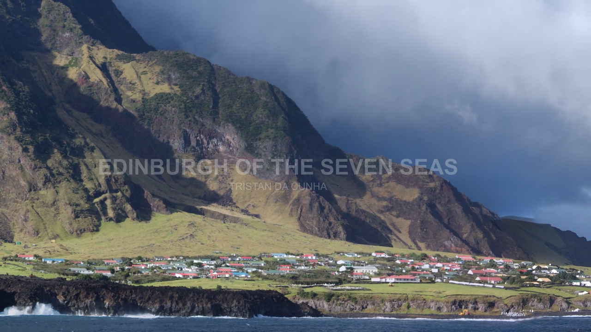
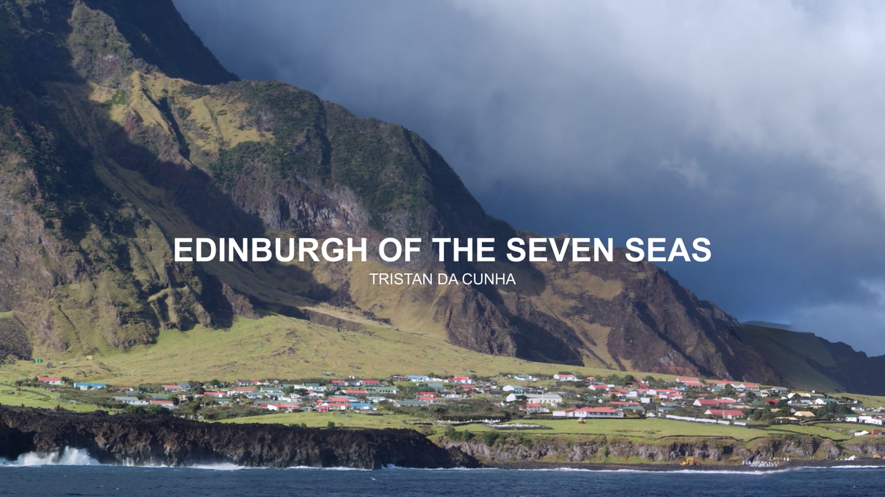
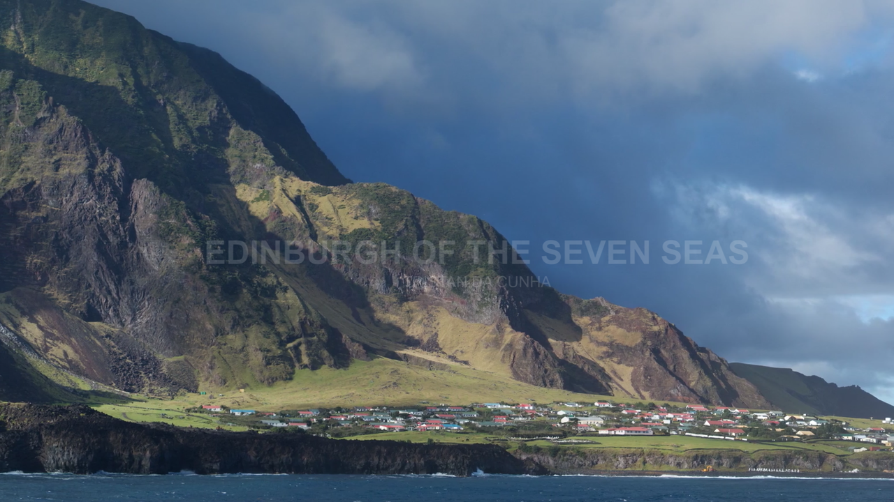
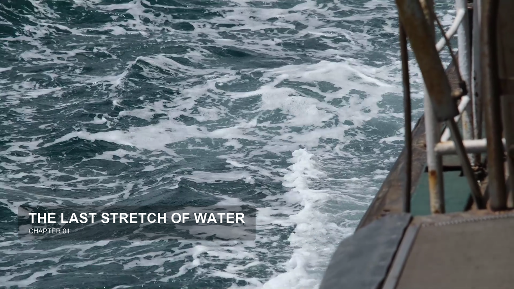
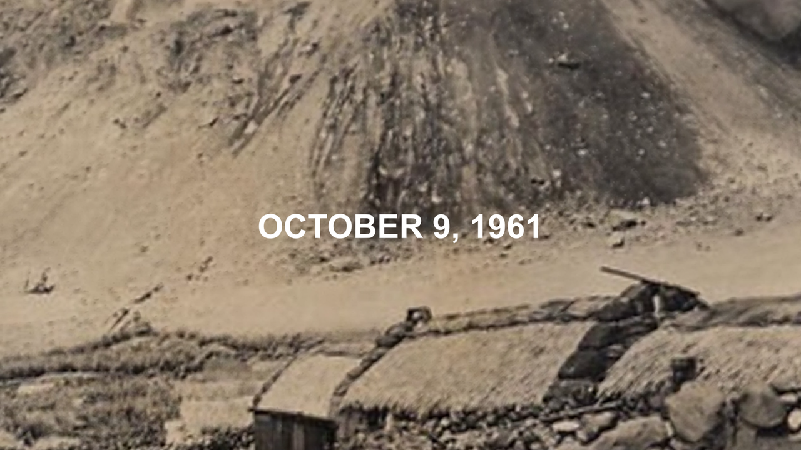
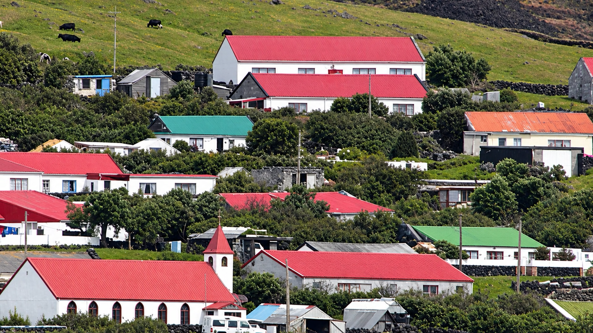

# Native text v28 — đối chiếu biến thể đã chạy

Frame capture qua Resolve native engine, PNG. Timeline Tristan v28, Free21.0.2.4, MCP4.8.22,30fps. Đã kiểm engine, chưa được user duyệt style làm mặc định. Không lấy tên/ngày của Tristan làm dữ kiện phim mới.

## Center location: vào → hold → ra

Text lớn căn giữa, subline nhỏ; slide ngắn + fade, alpha nền trong suốt. Graph editable [HC-Center-Slide-v28.comp](native-v28/HC-Center-Slide-v28.comp). Không dùng KeyFrameStretcher trên build không hỗ trợ; retime spline vào/hold/ra theo duration mới rồi native-test.

## Chapter — box khoảng30% opacity

## Fact/date

## Ảnh làng được phục chế từ ảnh thật

Chỉ đối chiếu framing và cover, không coi phần chi tiết AI tái dựng là bằng chứng lịch sử.
